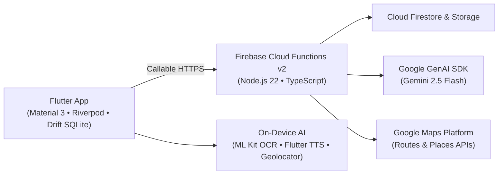

# LocalLens 🧭

> **AI-Powered, Crowd-Throttled Neighborhood Discovery & Street-Ready Co-Pilot**  
> *Built for Startup Buildathon India 2026 by **Team InnovoTribe***

[](https://github.com/Akhil-0190/locallens-app-prototype/releases/tag/v1.0.5)
[](https://flutter.dev)
[](https://dart.dev)
[](https://firebase.google.com)
[](https://ai.google.dev)
[](https://developers.google.com/maps)
[-brightgreen?style=flat-square)](#tests--verification)

---

## 📱 Download Android APK

* 🚀 **[Download LocalLens-Prototype-v1.0.5.apk](https://github.com/Akhil-0190/locallens-app-prototype/releases/download/v1.0.5/LocalLens-Prototype-v1.0.5.apk)**
* 📦 **[GitHub Releases Page](https://github.com/Akhil-0190/locallens-app-prototype/releases/tag/v1.0.5)**

---

## 💡 Overview

Travelers visiting historic neighborhoods often encounter crowded tourist traps, narrow alleys without English signage, and rigid generic itineraries. Meanwhile, family-run stalls and residents receive little benefit from tourist footfall.

**LocalLens** connects travelers with vetted everyday locals who share regional voice-and-photo notes. Grounded with Google Maps reviews and real-time venue capacity limits, it generates personalized, uncrowded walking routes and step-by-step street guidance.

---

## ⚡ Core Features

* **🎙️ 2-Minute Local Voice Curation**: Residents record casual voice memos and street photos in Kannada/English with zero technical friction.
* **🧭 Taste & Group Matchmaking**: Pairs solo travelers or groups (`Solo`, `2–3`, `4–5`, `6–7`, `7+`) with itineraries matching their budget, pace, and cultural palate (`#ScenicCruiser`, `#CurryConnoisseur`, `#HiddenGemHunter`, `#SunsetChaser`).
* **🚦 Crowd Throttling & Trap Filtering**: Venue hourly capacity gauges (`4/12 visitors`), authenticity scores, and warnings that filter out overcrowded tourist traps.
* **🎧 Street-Ready Co-Pilot**:
  * **Audio Cues**: Earphone walk-by cues with play/pause/stop controls.
  * **Vendor Order Cards**: Local phrases (e.g., Kannada greetings & ordering) with text-to-speech pronunciation.
  * **1-Tap Plan B**: Instantly swaps crowded spots with uncrowded alternatives nearby.
  * **Offline Edge Mode**: Pre-cached SQLite neighborhood packs for zero-connectivity alleys.
* **🤝 Direct Community Tipping**: Instant micro-tipping directly to everyday residents and family-run stalls.
* **✨ AI Multi-Day Trip Planner**: Auto-detects GPS coordinates, provides transit guidance from user location, builds 1–7 day custom itineraries, and syncs directly into the walking tour.

---

## 🛠️ Architecture & Tech Stack



| Layer | Technologies |
| :--- | :--- |
| **Mobile Client** | Flutter, Dart, Riverpod, GoRouter, Drift (SQLite), Flutter TTS, Google ML Kit |
| **Backend & Cloud** | Firebase Cloud Functions v2, Cloud Firestore, Firebase Storage |
| **AI & Grounding** | Google GenAI SDK (`@google/genai`, Gemini 2.5 Flash), Google Maps Routes & Places APIs |

---

## 🧪 Tests & Verification

| Test Suite | Total | Status |
| :--- | :---: | :---: |
| **Backend Functions & Security Tests** | 318 | ✅ 318 Passed (100%) |
| **Flutter Widget & Acceptance Tests** | 66 | ✅ 66 Passed (100%) |
| **Total** | **384** | **100% Clean Pass** |

---

## 🚀 Quick Start (Developers)

```bash
# 1. Clone repository
git clone https://github.com/Akhil-0190/locallens-app-prototype.git
cd locallens-app-prototype

# 2. Run mobile client
flutter pub get
dart run build_runner build --delete-conflicting-outputs
flutter test
flutter run

# 3. Build debug APK
flutter build apk --debug
```

---

## 👥 Team InnovoTribe — Startup Buildathon India 2026

* **Developer A — Godwin Judah J** *(Backend, Firebase & Integration Lead)*  
  Firebase infrastructure, Cloud Functions, data models, Firestore, security rules, App Check, and release verification. `Tasks: A1–A6.`

* **Developer B — Akshay G** *(AI & Intelligence)*  
  Gemini model configuration, structured schemas, regional voice/photo extraction, authenticity filtering, embeddings, and agent skills. `Tasks: B1–B7.`

* **Developer C — Akhil T V** *(Maps, Places & Routing)*  
  Google Maps Platform, Places API, walking route generation, venue capacity, crowd throttling, and Plan-B dynamic rerouting. `Tasks: C1–C6.`

* **Developer D — Aravinth S S** *(Flutter App, UI & Android)*  
  Flutter application, Material 3 UI, Riverpod state, GoRouter, offline packs & Drift SQLite, Android Kotlin integration, and demo readiness. `Tasks: D1–D7.`

---

## 📄 License

This project is licensed under the MIT License — see the [LICENSE](LICENSE) file for details.
