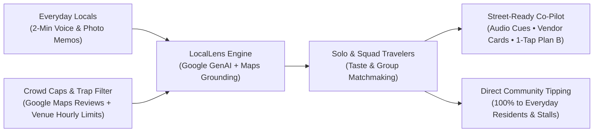
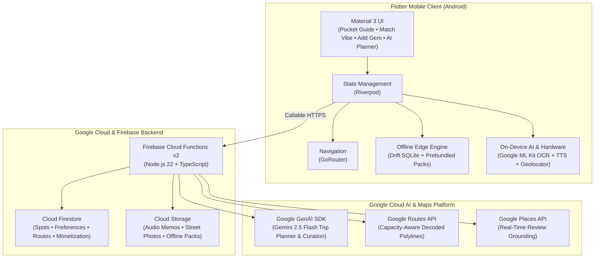

# LocalLens 🧭

> **AI-Powered, Crowd-Throttled Neighborhood Discovery & Street-Ready Co-Pilot**  
> *Developed for Startup Buildathon India 2026 by **Team InnovoTribe***

[](https://flutter.dev)
[](https://dart.dev)
[](https://firebase.google.com)
[-4285F4?style=for-the-badge&logo=google&logoColor=white)](https://ai.google.dev)
[](https://developers.google.com/maps)
[](#testing--verification)
[](https://github.com/Akhil-0190/locallens-app-prototype/releases/tag/v1.0.5)

---

## 📱 Quick Download (Android Prototype APK)

Download the verified Android APK directly from GitHub Releases:
* 🚀 **[Download LocalLens-Prototype-v1.0.5.apk](https://github.com/Akhil-0190/locallens-app-prototype/releases/download/v1.0.5/LocalLens-Prototype-v1.0.5.apk)**
* 📦 **[View GitHub Release v1.0.5](https://github.com/Akhil-0190/locallens-app-prototype/releases/tag/v1.0.5)**

---

## 🎯 Executive Summary & Problem Statement

Modern city travelers face three compounding challenges when exploring historic and vibrant urban neighborhoods:

1. **The Oversaturation Trap**: Social media algorithms and static travel blogs herd thousands of tourists to the exact same 5 spots. This produces suffocating 60-minute queues, degraded experiences, inflated prices, and cultural fatigue for local residents.
2. **Language & Narrow-Alley Barriers**: Historic neighborhoods like Bengaluru's Malleshwaram, Basavanagudi, and Indiranagar have their finest culinary gems and artisan workshops tucked away inside narrow alleys. They lack English storefronts, have unindexed Google Maps listings, and require regional language interactions to order.
3. **Zero Community Revenue Share**: Commercial travel bloggers monetize eyeballs via advertisements, leaving family-run stalls, heritage keepers, and everyday locals with zero economic benefit from tourist footfall.

### The LocalLens Solution (Pitch Deck Slide 4)

**LocalLens** is an AI-powered, crowd-throttled neighborhood discovery platform where vetted everyday locals share casual regional voice-and-photo notes, grounded with real-time Google Maps reviews and cultural data, to build personalized, uncrowded walking routes.



---

## ✨ Core Features & Value Pillars

### 1. 🎙️ 2-Minute Local Voice Curation
* Residents record casual regional audio notes and take quick storefront photos rather than writing long blogs.
* Zero technical barriers: speech-to-text, Kannada-to-English contextual translation, and automated hygiene/safety tagging.

### 2. 🧭 Taste & Group Matchmaking (Solo & Squads)
* Pairs solo explorers or friend groups with insiders sharing their exact cultural palate.
* Dynamic group sizing: `Solo (1)`, `Duo / Trio (2-3)`, `Small Crew (4-5)`, `Squad (6-7)`, and `Large Crew (7+)`.
* Gen Z cultural aesthetic tags: `#ScenicCruiser`, `#CurryConnoisseur`, `#HiddenGemHunter`, `#SunsetChaser`, `#Cottagecore`, `#StreetFoodJunkie`.

### 3. ⚡ Crowd Throttling & Tourist Trap Filtering
* **Venue Capacity Gauges**: Real-time hourly visitor tracking (`4/12 visitors`, `8 slots remaining`) prevents venue congestion.
* **Authenticity Scoring**: 90%+ authentic insider spot ratings grounded via Google Maps reviews.
* **Tourist Trap Detection**: Proactively flags overcrowded tourist hubs and commercialized gimmicks.

### 4. 🎧 Street-Ready Co-Pilot
* **Earphone Audio Cues**: Turn-by-turn regional narration with dedicated play/pause/stop audio controls.
* **Vendor Order Cards**: Instant regional language phrases (e.g. *"Namaskara! Oru filter coffee, please."*) with audio pronunciation via Flutter TTS.
* **1-Tap Dynamic Plan B Rerouting**: When a venue is crowded or closed, one tap seamlessly swaps the spot with a vetted, uncrowded nearby alternative.
* **100% Offline Edge Mode**: Bundled SQLite database via Drift and pre-cached neighborhood packs for zero-connectivity alleyways.

### 5. 🤝 Direct Community Monetization & Instant Micro-Tipping
* Instant digital tipping directly to the resident who curated the spot with 0% platform fee deduction.
* Community reputation ledger and walking pass revenue sharing for verified neighborhood insiders.

### 6. ✨ Gen Z AI Multi-Day Trip Planner (`/planner`)
* **Auto-GPS Detection**: Identifies the user's real-time coordinates via Geolocator.
* **Origin-to-Destination Transit Guidance**: Provides clear, multi-modal transit recommendations (Metro, Bus, Auto) to reach the target neighborhood.
* **Flexible Multi-Day Itineraries**: 1 to 7 day plans with morning, afternoon, and evening slots, best visiting hours, and direct Google Maps navigation links.
* **Walking Tour Synchronization**: 1-click button loads the generated plan directly into the active Street Walking Tour.

---

## 🖼️ Application Screens & User Journey

| Screen | Wireframe / Screenshot (Pitch Deck Slides 6 & 9) | Core Capabilities |
| :--- | :--- | :--- |
| **1. Add a Local Gem** | *Slide 9 Screenshot 1* | Local resident voice recording, venue photo upload, hygiene & safety tagging, Kannada greeting card curation. |
| **2. Explore Local Gems** | *Slide 9 Screenshot 2* | Authenticity score percentage, crowd level indicator (`4/12 visitors`), insider tips, and clean Google Maps directions. |
| **3. Match Your Vibe** | *Slide 9 Screenshot 3* | Traveler preference persona, group mode toggle (Solo vs Squad), pacing & budget filters, curated route previews. |
| **4. Street Pocket Guide** | *Slide 9 Screenshot 4* | Active trip header, audio cue earphone player, vendor order cards, 1-tap Plan B backups, and instant UPI tipping. |
| **5. AI Multi-Day Trip Planner** | *Slide 4 & Custom Feature* | Live GPS detection, transit guidance, squad sizing, aesthetic vibes, 1-7 day itineraries, and in-app route sync. |

---

## 🏗️ Architecture & Technology Stack



### Technology Breakdown

* **Mobile Frontend**:
  * **Flutter & Dart**: Cross-platform client with Material 3 responsive design.
  * **Riverpod (`flutter_riverpod`)**: Reactive, compile-safe dependency injection and state management.
  * **GoRouter**: Deep linking and declarative navigation.
  * **Drift (SQLite)**: 100% offline edge database storing cached neighborhood packs and local drafts.
  * **Flutter TTS (`flutter_tts`)**: Multilingual speech synthesis for audio cues and vendor phrases.
  * **Google ML Kit (`google_mlkit_text_recognition`)**: On-device optical character recognition for regional shop signs.
  * **Geolocator**: Precise GPS tracking for auto-step proximity detection.

* **Backend & Cloud Platform**:
  * **Firebase Cloud Functions (2nd Gen)**: Serverless microservices running on Node.js 22 and TypeScript.
  * **Cloud Firestore**: Enterprise NoSQL database storing verified spot cards, walking routes, and crowd ledgers.
  * **Cloud Storage**: Secure media storage for photos, voice memos, and offline pack JSON bundles.

* **AI & Grounding Layer**:
  * **Google GenAI SDK (`@google/genai`)**: Powered by Gemini 2.5 Flash for multi-day itinerary generation, regional voice memo parsing, and aesthetic vibe matching.
  * **Google Maps Platform (Routes & Places APIs)**: Polyline decoding, street walking directions, and place grounding against real-time business reviews.

---

## 🧪 Testing & Verification

The codebase is fortified with complete unit, integration, contract, and end-to-end acceptance test suites.

| Test Suite | Framework | Total Tests | Status |
| :--- | :--- | :---: | :---: |
| **Backend Functions & Security** | Node.js Test Runner (`node --test`) | **318** | ✅ **318 Passed (100%)** |
| **Flutter Client & Widget Tests** | Flutter Test (`flutter test`) | **66** | ✅ **66 Passed (100%)** |
| **Combined Total** | | **384** | ✅ **100% Clean Pass** |

### Verified Test Capabilities:
* **Contract Invariants**: Rigorous domain validation matching all shared data schemas (`01-canonical-gem` through `10-offline-packs`).
* **Fail-Closed Security**: Cloud Firestore & Storage security rules, App Check validation, and least-privilege authorization.
* **Idempotent Monetization**: Micro-tipping ledger settlement and walking route pass activation without double credits or race conditions.
* **Edge Resilience**: Full offline fallback to bundled JSON neighborhood packs when network connection is severed.

---

## 🚀 Getting Started (Developers)

### Prerequisites
* [Flutter SDK](https://flutter.dev) (v3.24+ recommended)
* [Node.js](https://nodejs.org/) (v22+)
* [npm](https://www.npmjs.com/)
* [Android Studio & Android SDK](https://developer.android.com/studio)
* Java JDK 17+ or 25

### 1. Clone the Repository
```bash
git clone https://github.com/Akhil-0190/locallens-app-prototype.git
cd locallens-app-prototype
```

### 2. Setup Mobile Application
```bash
# Install Flutter dependencies
flutter pub get

# Generate Drift SQLite database code
dart run build_runner build --delete-conflicting-outputs

# Run Flutter tests
flutter test
```

### 3. Setup Backend Functions
```bash
cd functions
npm install
npm run build
npm test
```

### 4. Build Android Debug APK
```bash
flutter build apk --debug
```
The compiled APK will be located at:
`build/app/outputs/flutter-apk/app-debug.apk`

---

## 👥 Team InnovoTribe — Startup Buildathon India 2026

* **Akhil S** — Mobile Architecture, On-Device Edge AI, Flutter Development & UI Engineering
* **InnovoTribe Team Members** — Backend Cloud Functions, AI Grounding Pipeline & Product Strategy

---

## 📄 License

This project is licensed under the MIT License — see the [LICENSE](LICENSE) file for details.
