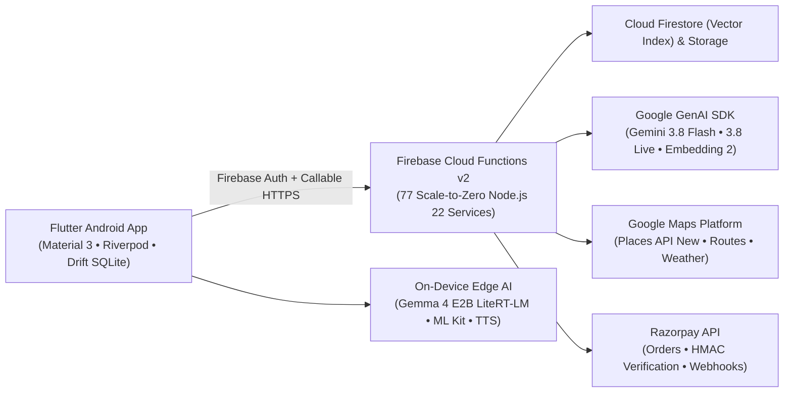

# LocalLens 🧭

> **AI-Powered, Crowd-Throttled Neighborhood Discovery & Offline-First Street Co-Pilot**  
> *Built for Startup Buildathon India 2026 by **Team InnovoTribe***

[](https://github.com/Akhil-0190/locallens-app-prototype/releases/tag/v2.0.0)
[](https://flutter.dev)
[](https://dart.dev)
[](https://firebase.google.com)
[](https://ai.google.dev)
[](https://developers.google.com/maps)
[-brightgreen?style=flat-square)](#tests--verification)

---

## 📱 Download Android APK (`v2.0.0`)

* 🚀 **[Download LocalLens-v2.0.0-release.apk (Prototype Repo)](https://github.com/Akhil-0190/locallens-app-prototype/releases/download/v2.0.0/LocalLens-v2.0.0-release.apk)**
* 📦 **[GitHub Releases (Prototype Repo)](https://github.com/Akhil-0190/locallens-app-prototype/releases/tag/v2.0.0)** | **[GitHub Releases (Main Repo)](https://github.com/goddy04/neighborhoodguideapp/releases/tag/v2.0.0)**

> **Requirements:** Android 8.0+ (`minSdk 26`). For on-device **Gemma 4 E2B Multimodal (LiteRT-LM)** offline AI, devices with **>= 6 GB RAM** and **>= 4 GB free storage** auto-enable GPU/CPU edge inference over Wi-Fi; devices with `< 6 GB RAM` safely fall back to ML Kit On-Device OCR + cached Drift neighborhood packs.

---

## 💡 Overview

Travelers exploring historic neighborhoods often face crowded tourist traps, narrow alleys without English signage, spotty mobile reception, and generic itineraries. Meanwhile, everyday local residents and family-run stalls rarely benefit from visitor footfall.

**LocalLens** connects travelers with vetted local residents who share 2-minute vernacular voice-and-photo notes. Every contribution is extracted with **Gemini 3.8 Flash**, grounded via **Google Maps Places API (New)** and **Google Search**, matched to solo or group palates via **768-dim Gemini Embedding 2 Firestore Vector Search**, balanced with real-time hourly venue capacity caps, and delivered both online (**Gemini 3.8 Live**) and **100% offline** (**Gemma 4 E2B via LiteRT-LM** + disk-cached map tiles).

---

## ⚡ Core Capabilities (v2.0.0 Production Release)

### Stage 1 — Local Contribution & Grounded Synthesis
* **🎙️ 2-Minute Regional Voice & Street Photo Ingestion**: Residents record vernacular voice memos (up to 120s) + photos uploaded directly to Firebase Storage under verified Firebase Auth UIDs.
* **🧠 Gemini 3.8 Flash Multimodal Synthesis**: Server-side Cloud Function trigger (`Contributions-onAssetCreated`) transcribes audio/photos into structured Spot Cards.
* **📍 Google Maps & Search Grounding**: Verifies real coordinates, opening hours, rating/review sentiment, tourist-trap scores (Places API New), plus heritage stories & visitor safety notices (Google Search grounding).
* **🗣️ Persistent Community Signals**: Live community dialect cards, hygiene/safety badges, and 1-tap crowd level reports persisted in Firestore (`Community-submitPlaceSignal`).

### Stage 2 — AI Discovery, Group Matchmaking & Crowd Balancing
* **🧭 768-Dim Vector Matchmaking**: Solo and real-time multi-user Group Sessions (`6-char join codes`) compute consensus taste vectors via **Gemini Embedding 2** (`gemini-embedding-001`) + Firestore KNN vector search (`Discovery-matchSoloSpots`, `Discovery-matchGroupSpots`).
* **🌦️ Live Weather & Atomic Hourly Capacity**: Filters outdoor stops during rain via Google Weather API and reserves atomic hourly visit slots (`Capacity-bookScheduledVisit`) to prevent overcrowding.
* **✨ AI Multi-Day Trip Planner**: Detects GPS location, builds 1–7 day custom itineraries (`Assistance-generateTripPlan`), and loads grounded neighborhood stops directly into the Walking Tour.

### Stage 3A — Live Street Assistance & Community Commerce
* **🎙️ Bidirectional Gemini 3.8 Live Voice Translator**: Real-time WebSocket PCM audio streaming (`Assistance-initializeLiveSession` ephemeral tokens) with live bidirectional transcripts.
* **🪧 Dynamic Vendor Order Cards**: Generates spot-specific regional ordering phrases with phonetics & TTS audio (`Assistance-getOrderingPhrases`).
* **🗺️ Live Google Routes & 1-Tap Plan-B Rerouting**: Real pedestrian polylines (`Maps-computeCapacityAwareRoute`) and instant detour swaps when a venue hits capacity or weather shifts (`Maps-computePlanBReroute`).
* **💳 Razorpay Checkout & 20% Contributor Revenue Share**: Live Razorpay Test/Live checkout (`razorpay_flutter`) with server-side HMAC-SHA256 verification, atomic contributor reward ledgers (95% direct tips), Route Passes (`₹99` / `₹299` / `₹999` with 20% pro-rata contributor revenue share), and KYC resident verification (`Monetization-submitVerificationRequest`).

### Stage 3B — 100% Offline Edge Mode
* **🤖 On-Device Gemma 4 E2B Multimodal (LiteRT-LM)**: Hardware-gated Android Kotlin bridge (`GemmaEdgeRuntime.kt`) supporting GPU (`>= 10 GB RAM`) and CPU (`>= 6 GB RAM`) delegates for offline street Q&A and **140+ language offline camera sign/menu translation** directly from pixels.
* **📦 Live-Built Offline Neighborhood Packs & Disk Map Tiles**: Backend `LocalAI-generateNeighborhoodPack` compiles live Firestore spots, computed walking routes, and SHA-256 checksums into Firebase Storage; the app caches spots/routes in Drift SQLite and pre-downloads OSM raster tiles to disk for zero-network Airplane Mode map rendering.
* **🔊 Hands-Free GPS Audio Cues**: Automatically speaks upcoming turn-by-turn cues via offline `flutter_tts` when within `25m` of the next waypoint (or off-route `> 40m`).

---

## 🛠️ Architecture & Tech Stack



| Layer | Technologies |
| :--- | :--- |
| **Mobile Client** | Flutter, Dart, Riverpod, GoRouter, Drift (SQLite), `flutter_map` (disk tiles), `google_maps_flutter`, `razorpay_flutter`, `flutter_tts`, `record` |
| **On-Device AI (Android)** | LiteRT-LM (`litertlm-android` + Gemma 4 E2B `.litertlm`), ML Kit GenAI Prompt / OCR (Latin + Devanagari) |
| **Backend & Cloud** | Firebase Cloud Functions v2 (Node.js 22, TypeScript, scale-to-zero), Cloud Firestore (768-dim vector index), Firebase Auth, Cloud Storage, Secret Manager |
| **AI & Grounding** | `@google/genai` (`gemini-3.8-flash`, `gemini-3.8-live`, `gemini-embedding-001`), Google Maps Places API (New), Routes API, Weather API |

---

## 🧪 Tests & Verification

All automated quality gates and the Phase 6 mock-eradication CI guard pass cleanly:

```bash
# Backend TypeScript build + 318 unit/contract/security tests
npm --prefix functions run build
npm --prefix functions test

# Scorched-Earth Mock-Eradication Audit Gate (0 violations across lib/ & functions/src/)
npm --prefix functions run audit:mocks

# Flutter static analysis (0 errors) + 66 unit & widget tests
flutter analyze --no-fatal-infos --no-fatal-warnings
flutter test
```

| Verification Gate | Status |
| :--- | :--- |
| Backend Cloud Functions (`npm --prefix functions test`) | **318 / 318 Passing** (`80` suites) |
| Flutter Unit & Widget Suite (`flutter test`) | **66 / 66 Passing** |
| Mock-Eradication Audit (`npm --prefix functions run audit:mocks`) | **0 Violations** (`60` Dart + `86` prod TS files) |
| Live Firebase Cloud Functions (`neighborhoodguideapp-35856`) | **77 / 77 ACTIVE** (`0` failed, `0` idle `minInstances`) |

---

## 🚀 Quick Start (Developers)

```bash
# 1. Clone repository
git clone https://github.com/Akhil-0190/locallens-app-prototype.git
cd locallens-app-prototype

# 2. Configure local Maps API key for Android (gitignored)
# Add MAPS_API_KEY=<your_android_maps_key> to android/local.properties

# 3. Install & verify Flutter client
flutter pub get
dart run build_runner build --delete-conflicting-outputs
flutter test

# 4. Build release Android APK
flutter build apk --release

# 5. Build, test & audit Cloud Functions backend
npm --prefix functions install
npm --prefix functions test
npm --prefix functions run audit:mocks
```

---

## 👥 Team InnovoTribe — Startup Buildathon India 2026

* **Developer A — Godwin Judah J** *(Backend, Firebase & Integration Lead)*  
  Firebase infrastructure, Cloud Functions, data models, Firestore, security rules, App Check, monetization, and release verification. `Tasks: A1–A6.`

* **Developer B — Akshay G** *(AI & Intelligence)*  
  Gemini 3.8 model configuration, structured schemas, regional voice/photo extraction, authenticity filtering, embeddings, Live API, Gemma 4 E2B, and agent skills. `Tasks: B1–B7.`

* **Developer C — Akhil T V** *(Maps, Places & Routing)*  
  Google Maps Platform, Places API (New), Routes API walking generation, Weather API, venue capacity, crowd throttling, and Plan-B dynamic rerouting. `Tasks: C1–C6.`

* **Developer D — Aravinth S S** *(Flutter App, UI & Android)*  
  Flutter application, Material 3 UI, Riverpod state, GoRouter, offline packs & Drift SQLite, Android Kotlin LiteRT-LM integration, and release builds. `Tasks: D1–D7.`

---

## 📄 License

This project is licensed under the MIT License — see the [LICENSE](LICENSE) file for details.
